<div align="center">

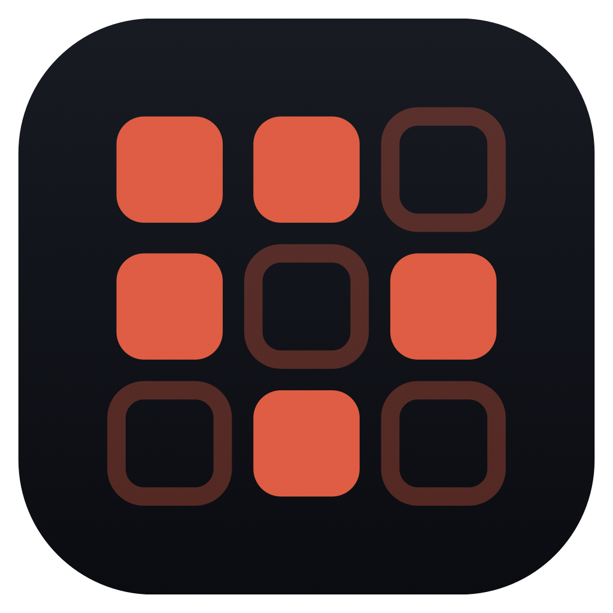

# PokeTokenBar

**Your AI coding tokens, hatched into Pokémon — right in your menu bar.**

[](https://github.com/chattymin/PokeTokenBar/releases)
[](https://www.apple.com/macos/)
[](https://swift.org)
[](#homebrew)
[](LICENSE)
[](https://github.com/sponsors/chattymin)

<a href="https://trendshift.io/repositories/84522?utm_source=repository-badge&amp;utm_medium=badge&amp;utm_campaign=badge-repository-84522" target="_blank" rel="noopener noreferrer"></a>
<a href="https://trendshift.io/repositories/84522?utm_source=trendshift-badge&amp;utm_medium=badge&amp;utm_campaign=badge-trendshift-84522" target="_blank" rel="noopener noreferrer"></a>

**English** · [한국어](README.ko.md) · [日本語](README.ja.md)

</div>

PokeTokenBar turns the AI coding tokens you're already burning — Claude Code, Codex, Gemini CLI, Antigravity, OpenCode, Hermes Agent, Cursor, Grok CLI, Copilot CLI, Kiro CLI, Pi Agent, omp, Aside & Kimi Code — into a growing **Pokémon companion** in your macOS menu bar. Spend tokens, hatch an egg, evolve it through its real evolution line, graduate it into your Pokédex, and start again. Underneath the companion it's a precise usage tracker — today's spend, cost, and official 5-hour / weekly limits, read straight from your local logs.

> Token usage is read directly from local Claude Code, Codex, Gemini CLI, Antigravity, OpenCode, Hermes Agent, Cursor, Grok CLI, Copilot CLI, Kiro CLI, Pi Agent, omp, Aside, and Kimi Code data (`totalTokens` = input + output + cache, local date) — no external CLI needed. Unofficial, non-commercial Pokémon fan project — see [License & disclaimer](#license--disclaimer).

## Why

- **The usage tracker you actually enjoy opening.** Your spend raises a Pokémon that hatches, evolves, graduates, and fills a Pokédex — and every shiny is a reason to check back.
- See today's token spend & cost at a glance — no dashboard, no browser tab.
- Track official **5-hour / weekly** limits with reset countdowns and a burn-rate forecast for when you'll hit them.

<div align="center">

</div>

## How it works

1. 🥚 **Code as usual.** The tokens you burn in Claude Code, Codex, Gemini CLI, Antigravity, OpenCode, Hermes Agent, Cursor, Grok CLI, Copilot CLI, Kiro CLI, Pi Agent, omp, Aside, or Kimi Code incubate an egg — nothing extra to run.
2. 🐣 **Hatch.** Eggs hatch into Pokémon with real evolution lines from [PokéAPI](https://pokeapi.co/) — any Gen 1–5 line (329 possible starts), weighted by the official capture rate: commons hatch often, a legendary is a 1-in-129 event. It appears in your **Pokédex** immediately while you raise it. Every hatch rolls one of 25 natures — and once in a rare while, the egg hatches **✨ Shiny**.
3. ⚡ **Evolve.** Keep coding and it grows through its actual evolution tree (1/2/3 stages, branching), with a little flash celebration at each step.
4. 🎓 **Graduate & collect.** Final form + threshold permanently archives it in your **Pokédex** — rarer takes longer (≈3 days common → ≈24 days legendary at heavy use) — and a fresh egg arrives.
5. 🍬 **Max out, get a candy.** Fill a 5-hour or weekly usage limit and you earn **Rare Candy** — spend it from the **Bag** to grow your current Pokémon.
6. 🛒 **Spend at the Shop.** Every token you've used is spendable currency — buy **Rare Candy**, a **Mint** that re-rolls your Pokémon's nature, a **Shiny Charm** that permanently raises your shiny odds, or an egg to send off your current companion and start over. Eggs come in three grades: a plain **Pokémon Egg**, an **Uncommon Egg** guaranteed to hatch Uncommon or better, and a **Rare Egg** guaranteed to hatch Rare or better. Once your Pokédex holds the Pokémon they ask for, **evolution stones**, **legendary artifacts** and **gym badges** can be claimed for free from the **Achievements** tab.

## Tour

<table>
<tr>
<td width="45%" align="center">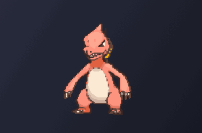</td>
<td width="55%" valign="middle">
<h3>🐾 Let it live on your desktop</h3>
Move your companion out of the menu bar and onto the desktop, at any size from 48 to 384px. Hover it for today's usage, click to open the popover, right-click for a menu, drag it wherever you like — and limit alerts can appear as a speech bubble above it.
</td>
</tr>
<tr>
<td width="55%" valign="middle">
<h3>In your menu bar</h3>
An animated Gen-V sprite lives next to today's total tokens (compact, e.g. <code>200.7M</code>). Add today's cost (<code>$</code>) or official limit <code>%</code> — or turn everything off for a character-only bar.
</td>
<td width="45%" align="center"></td>
</tr>
<tr>
<td width="45%" align="center">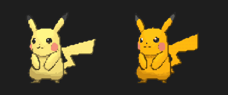</td>
<td width="55%" valign="middle">
<h3>✨ Once in a rare while — Shiny</h3>
Shiny hatches keep their distinct colors through every evolution — menu bar, home card, evolution line. In the Pokédex, species you own shiny show their shiny colors and a ✨ marker; the detail page lets you switch between owned normal and shiny appearances. Unown keeps its A icon in the grid, with letter and color choices in its details. A dedicated notification makes sure you don't miss the moment.
</td>
</tr>
<tr>
<td width="55%" valign="middle">
<h3>A Pokédex worth filling</h3>
The <b>Pokédex</b> folds every species you've owned into one cell — 16 per page in a 4×4 grid. Search by name or number, filter by rarity or shiny appearance, and change the sort order. Turn pages with the scroll wheel or trackpad, or use the larger arrow hit areas. Click a collected Pokémon on Home, its evolution line, or the <b>Catch log</b> to open its details; Back returns to its Pokédex page or the log row you opened. The log keeps each individual's full evolution line, rarity, nature, and capture date.
</td>
<td width="45%" align="center">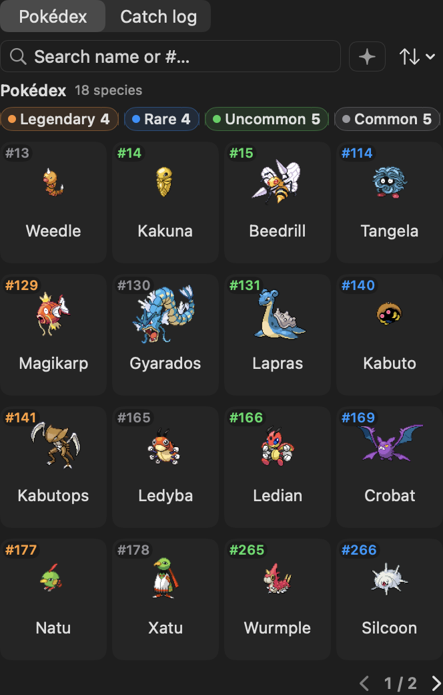<br><br>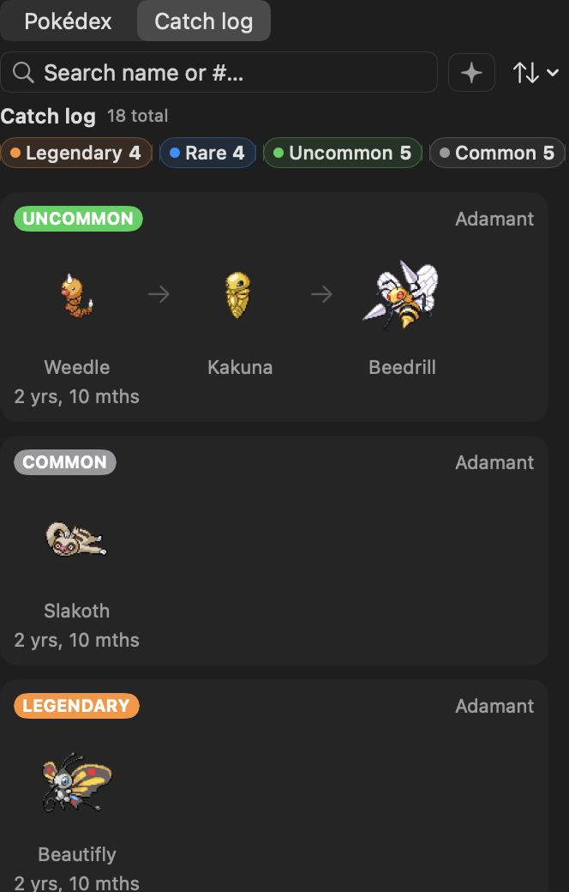</td>
</tr>
<tr>
<td width="45%" align="center">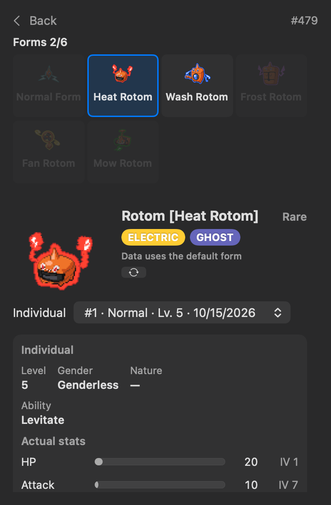<br><small>Production UI rendered locally with sample Pokémon.</small></td>
<td width="55%" valign="middle">
<h3>Collect more than one look</h3>
Collect Rotom appliances, Shaymin's Land and Sky Formes, Deerling seasons, Unown letters, and other supported Gen 1–5 forms. The Pokédex shows your form count and the individuals in each form. Choose an owned form as your menu-bar and floating-pet representative. An East Sea Shellos keeps its appearance when it becomes Gastrodon, and forms stay in saves and exports. Types, stats, abilities, and moves use the default form’s data.
</td>
</tr>
<tr>
<td width="45%" align="center">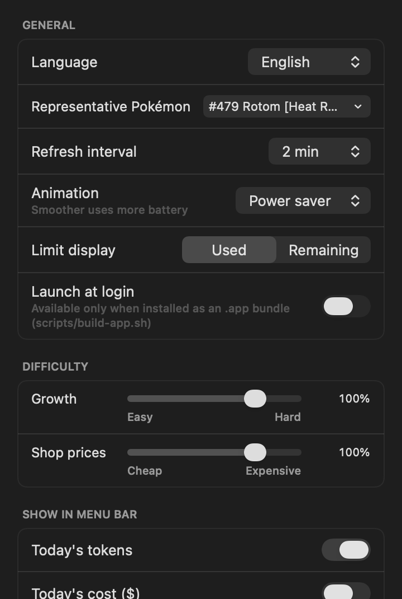</td>
<td width="55%" valign="middle">
<h3>Tune it your way</h3>
Menu-bar items, refresh interval (1–15 min or manual), launch at login, a Keychain opt-out that just hides the limits section, limit alerts with warning/critical thresholds, and companion event notifications. Full <b>KO / EN / JA / ES / FR / PT / DE / RU</b> UI; Pokémon, type, ability, and move names use your language when available and otherwise fall back to English.
</td>
</tr>
<tr>
<td width="55%" valign="middle">
<h3>🍬 Fill a limit, earn a Rare Candy</h3>
Max out a 5-hour or weekly usage limit and you're handed a <b>Rare Candy</b> — one per 5-hour cap, five per weekly. Spend it from the new <b>Bag</b> tab to grow your current Pokémon: the moment you're rate-limited becomes the moment you level up.
</td>
<td width="45%" align="center">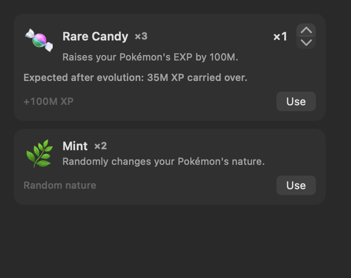</td>
</tr>
<tr>
<td width="45%" align="center">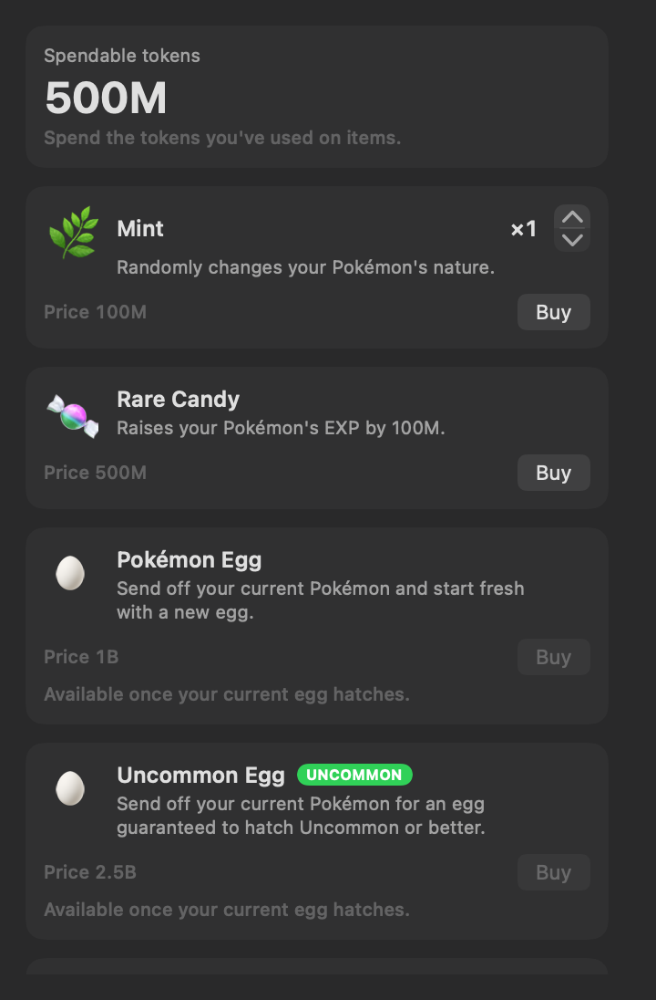</td>
<td width="55%" valign="middle">
<h3>🛒 A shop that runs on your usage</h3>
The tokens you've already used are your currency. Buy several consumables at once with a quantity selector and total-price preview: <b>Rare Candy</b> grows your Pokémon, and a <b>Mint</b> re-rolls its nature. A <b>Shiny Charm</b> permanently raises your shiny hatch odds. Eggs send off your companion and start over: a plain <b>Pokémon Egg</b>, an <b>Uncommon Egg</b> guaranteed to hatch Uncommon or better, or a <b>Rare Egg</b> guaranteed to hatch Rare or better. Legendaries stay in both graded pools. An empty Bag links straight to the Shop.
</td>
</tr>
<tr>
<td width="55%" valign="middle">
<h3>📊 Official limits, now for Antigravity too</h3>
Antigravity 2.0 and the IDE report real quota, not an estimate. Gemini models and Claude &amp; GPT models each get their own <b>5-hour</b> and <b>weekly</b> buckets with reset countdowns, alongside Claude Code and Codex. Background reads use the token file and can refresh OAuth credentials automatically; a manual refresh may still access the Keychain.
</td>
<td width="45%" align="center">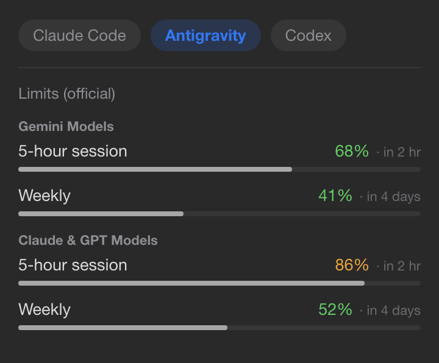</td>
</tr>
<tr>
<td width="45%" align="center">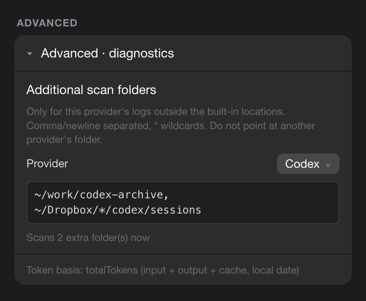</td>
<td width="55%" valign="middle">
<h3>📁 Logs somewhere unusual? Point at them</h3>
If a tool keeps its sessions outside the built-in paths, add your own roots under <b>Settings → Advanced</b> — comma or newline separated, <code>*</code> wildcards, with a live count of how many extra folders currently match. Every provider keeps its own list, so one tool's folders are never handed to another tool's parser, and your custom roots are added to the built-in ones rather than replacing them.
</td>
</tr>
<tr>
<td width="55%" valign="middle">
<h3>🔑 Official limits without the Keychain</h3>
If the cached limit token expires, official Claude limits used to freeze until a refresh — and that press could raise a Keychain password prompt. Paste a <b>claude.ai session key</b> under <b>Settings → Advanced</b> instead: limits then come straight from claude.ai with no Keychain access at all, auto-polling keeps them fresh, and the key is validated the moment you save it.
</td>
<td width="45%" align="center">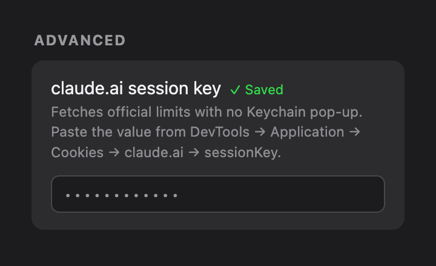</td>
</tr>
<tr>
<td width="45%" align="center">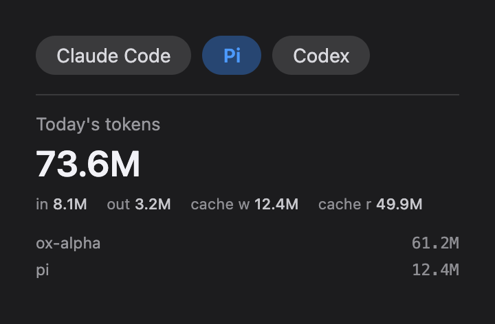</td>
<td width="55%" valign="middle">
<h3>🧮 One session log, several models</h3>
Pi can route more than one model through a single session log. Usage is now attributed to the <b>real model id</b> instead of a flat "pi", and when a day spans several models the popover breaks today's tokens down per model, biggest first.
</td>
</tr>
<tr>
<td width="45%" align="center">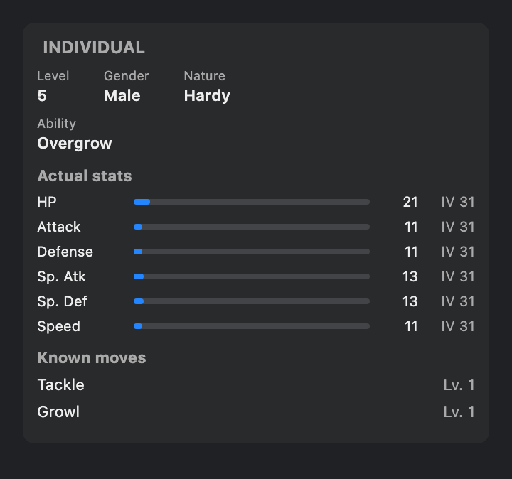</td>
<td width="55%" valign="middle">
<h3>Every Pokémon has its own profile</h3>
Open a species in the <b>Pokédex</b> to inspect each individual: level, gender, nature, ability, IVs, calculated stats, and learned moves. Species descriptions, abilities, and moves use your selected language, with English as the fallback when PokéAPI has no translation.
</td>
</tr>
<tr>
<td width="45%" align="center">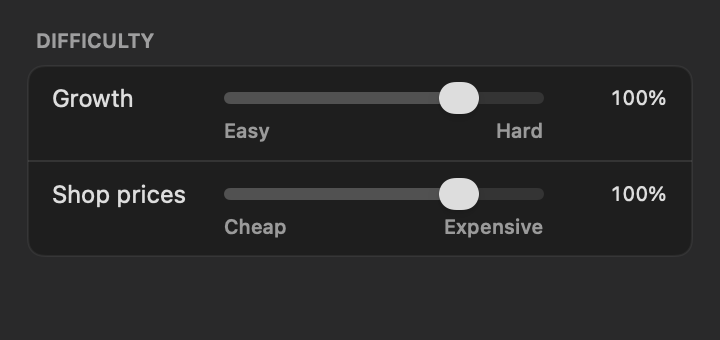</td>
<td width="55%" valign="middle">
<h3>Choose your growth pace</h3>
Set growth thresholds and shop prices independently from <b>10% to 200%</b>, with Easy/Hard and Cheap/Expensive labels at the slider ends. Dragging only edits a draft; press <b>Save</b> to apply it. Changing growth difficulty preserves your current stage progress instead of triggering an evolution. A hatch from an evolution line you have already graduated grows <b>2× faster</b>. Hover the hatch or growth bar on Home to see used tokens, the target, and progress as a percentage.
</td>
</tr>
<tr>
<td width="45%" align="center">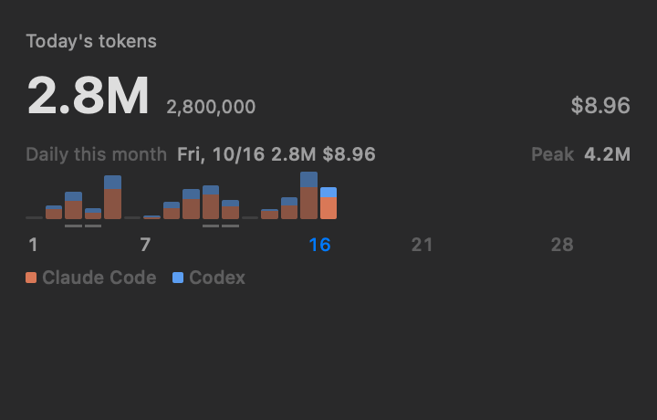</td>
<td width="55%" valign="middle">
<h3>Your month, day by day</h3>
The daily chart keeps every date in the calendar month in place, with future dates left blank. When you use two or more tools this month, each day's bar stacks their usage in separate colors with a legend. Hover for that day's total and per-tool tokens and cost when enabled. Weekly and monthly history, plus the recap shortcut, stay visible even when today's usage is zero.
</td>
</tr>
<tr>
<td width="45%" align="center">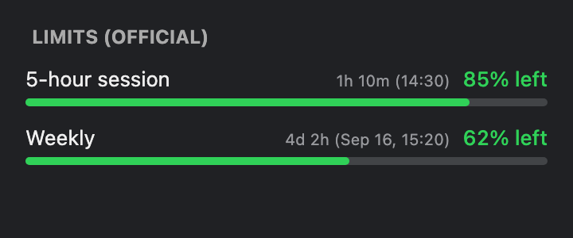</td>
<td width="55%" valign="middle">
<h3>Limits you can scan at a glance</h3>
Reset countdowns include the clock time, and the colored percentage stays aligned at the right edge across all quota rows. Choose used or remaining in Settings: both the number and the bar follow that choice.
</td>
</tr>
</table>

## Collector items

Each collector item stays **locked** until you register the Pokémon it asks for in your Pokédex: graduated or released Pokémon count, and so do the stages your current Pokémon has reached. Every collector item is then claimed for free from the **Achievements** tab, whose title counts the rewards ready to claim. There, a locked card shows the Pokémon it needs, greyed out until registered; once claimed, the card keeps the goal as a small reminder.

### Evolution Stones

Claiming a stone's achievement puts **5** of that stone in the Bag, next to the other consumables. Using one sends off your current companion right away (it stays in the Pokédex as released) for a fresh egg guaranteed to hatch a Pokémon of the stone's type, so a stone waits until there is a companion to send off. Each stone achievement is claimed once, and stones are not sold in the Shop.

| Stone | Sprite | Egg type | Unlocks with |
| :--- | :---: | :---: | :--- |
| **Leaf Stone** |  | Grass | Venusaur, Charizard, Blastoise |
| **Fire Stone** |  | Fire | Meganium, Typhlosion, Feraligatr |
| **Water Stone** |  | Water | Sceptile, Blaziken, Swampert, **or** Vaporeon, Jolteon, Flareon |
| **Thunder Stone** |  | Electric | Raichu, Jolteon, Eelektross |
| **Sun Stone** |  | Psychic | Torterra, Infernape, Empoleon |
| **Moon Stone** |  | Fairy | Serperior, Emboar, Samurott |
| **Dusk Stone** |  | Dark | Espeon, Umbreon |
| **Ice Stone** |  | Ice | Leafeon, Glaceon |
| **Dawn Stone** |  | Fighting | Gallade, Froslass |
| **Shiny Stone** |  | Dragon | Dragonite, Salamence, Rayquaza |

### Legendary Artifacts

Claimed once from the **Achievements** tab, active for as long as they sit in the Bag.

| Artifact | Sprite | Unlocks with | Effect |
| :--- | :---: | :--- | :--- |
| **Azure Flute** |  | The same legendary Pokémon graduated twice | Legendary Pokémon hatch 4× as often |
| **Silver Wing** |  | Articuno, Zapdos, Moltres | Halves the tokens an egg needs to hatch |
| **Old Sea Map** |  | Mewtwo, Mew | +20% growth from token usage |
| **Clear Bell** |  | Raikou, Entei, Suicune | Rare-tier Pokémon hatch 2× as often |
| **Rainbow Wing** |  | Lugia, Ho-Oh | 25% off every shop purchase |
| **Magma Stone** |  | Regirock, Regice, Registeel, **or** any 4 fossil Pokémon¹ | Lines you already graduated need 25% less growth |
| **Soul Dew** |  | Latias, Latios | Rare Candy gives 50% more EXP |
| **Jade Orb** |  | Kyogre, Groudon, Rayquaza | An extra 20% off eggs |
| **Gracidea** |  | Uxie, Mesprit, Azelf | Every Rare Candy you get comes with one more |
| **Griseous Orb** |  | Dialga, Palkia, Giratina | Ghost- and Dragon-type Pokémon hatch 2× as often |
| **Liberty Pass** |  | Cobalion, Terrakion, Virizion | Lines you never graduated need 25% less growth |
| **Reveal Glass** |  | Tornadus, Thundurus, Landorus | Doubles the shiny odds (stacks with the Shiny Charm) |
| **DNA Splicers** |  | Reshiram, Zekrom | +50% growth from token usage |

¹ Omastar, Kabutops, Aerodactyl, Cradily, Armaldo, Rampardos, Bastiodon, Carracosta, Archeops.

### Gym Badges

Register every Gen 1 to 5 Pokémon of a type to unlock its badge, then claim it from the **Achievements** tab. While owned, a badge makes the Pokémon weak to its type hatch 20% more often and grow 20% faster, stacking when a Pokémon is weak to several owned badges.

| Badge | Sprite | Type | Unlocks with | Boosts Pokémon weak to it |
| :--- | :---: | :---: | :--- | :--- |
| **Boulder Badge** |  | Rock | All 47 Rock-type Pokémon | Fire, Ice, Flying, Bug |
| **Cascade Badge** |  | Water | All 109 Water-type Pokémon | Fire, Ground, Rock |
| **Thunder Badge** |  | Electric | All 39 Electric-type Pokémon | Water, Flying |
| **Rainbow Badge** |  | Grass | All 75 Grass-type Pokémon | Water, Ground, Rock |
| **Soul Badge** |  | Poison | All 57 Poison-type Pokémon | Grass, Fairy |
| **Marsh Badge** |  | Psychic | All 68 Psychic-type Pokémon | Fighting, Poison |
| **Volcano Badge** |  | Fire | All 48 Fire-type Pokémon | Grass, Ice, Bug, Steel |
| **Earth Badge** |  | Ground | All 58 Ground-type Pokémon | Fire, Electric, Poison, Rock, Steel |
| **Zephyr Badge** |  | Flying | All 82 Flying-type Pokémon | Grass, Fighting, Bug |
| **Hive Badge** |  | Bug | All 63 Bug-type Pokémon | Grass, Psychic, Dark |
| **Plain Badge** |  | Normal | All 89 Normal-type Pokémon | Normal (no type is weak to Normal) |
| **Fog Badge** |  | Ghost | All 27 Ghost-type Pokémon | Psychic, Ghost |
| **Storm Badge** |  | Fighting | All 40 Fighting-type Pokémon | Normal, Ice, Rock, Dark, Steel |
| **Mineral Badge** |  | Steel | All 37 Steel-type Pokémon | Ice, Rock, Fairy |
| **Glacier Badge** |  | Ice | All 29 Ice-type Pokémon | Grass, Ground, Flying, Dragon |
| **Rising Badge** |  | Dragon | All 29 Dragon-type Pokémon | Dragon |
| **Dark Badge** |  | Dark | All 39 Dark-type Pokémon | Psychic, Ghost |
| **Fairy Badge** |  | Fairy | All 22 Fairy-type Pokémon | Fighting, Dragon, Dark |

## Also in the box

- **Menu-bar shortcuts** — right-click or Control-click for today's summary, Refresh, Pokédex, Settings, floating-pet visibility, and Quit.
- **Low Power Mode** — menu-bar animation continues at Power saver quality.
- **Reconnect refresh** — usage and limits refresh when the network comes back.
- **Representative Pokémon** — pin any owned Pokédex species to the menu bar and optional floating pet, independently of the companion you're raising. While pinned, the menu bar stops following egg, hatch, and evolution changes; raising progress remains visible on Home.
- **Animation quality** — pick how smoothly the menu bar sprite and the floating pet animate (Power saver / Balanced / Smooth). Both always-visible surfaces share the setting. Power saver is the default and keeps the frame rate the app used before this setting existed; Balanced and Smooth trade battery for smoothness (measured idle CPU ~1.8% and ~5.1%).
- **Interactive floating pet** — hover for today's usage, click to open the main window, right-click for a menu, and show limit alerts as speech bubbles.
- **Per-service tabs** — when two or more of Claude Code, Codex, Gemini CLI, Antigravity, OpenCode, Hermes Agent, Cursor, Grok CLI, Copilot CLI, Kiro CLI, Pi Agent, omp, Aside, and Kimi Code are detected, compact tabs switch between them; today's total stays combined.
- **Official limits** — Claude, Codex & Antigravity 5-hour / weekly utilization with reset countdowns, right under today's numbers.
- **Additional scan folders** — per-provider extra scan roots for logs kept outside the built-in paths (Settings → Advanced).
- **Several Claude accounts** — Claude Code logins kept in their own config folder (`CLAUDE_CONFIG_DIR`) each get a tab under the official limits, with their own gauges, Rare Candy, alerts, and today/month tokens. `~/.claude-*` folders and an exported `CLAUDE_CONFIG_DIR` are found automatically; add others in Settings → Advanced. The menu bar percentage, companion mood, and forecast follow the account you used last (Settings → General → Tracked Claude account). Each account can take its own claude.ai session key (Settings → Advanced), so its limits keep refreshing without the Keychain.
- **Burn-rate forecast** — projects when the current 5h window hits 100%.
- **In-app updates** — one-click update check; current version shown in Settings.
- **Usage recap** — a Pokédex-style recap of any week, month, or year (total, meters, comparison, best day, best streak, graduations). Hover a meter for its date and full token count, and jump back to This week / This month / This year in one click. History is kept locally for this year and the last.

- **Local save backups** — automatic snapshots and corruption recovery, with a restore screen in Settings. Backup history starts collapsed; expand it to browse snapshots. **Create snapshot** stays available outside the list.
- **Pokémon forms** — collect Gen 1–5 alternate forms, inspect form-specific individuals, and pin an owned form to the menu bar and floating pet. An individual's form follows evolution and stays in saves and exports; existing Unown letter saves remain readable. See the [form catalog](docs/reference/pokemon-forms.md).
- **Bulk Rare Candy** — use several candies at once and preview the growth before spending.
- **Quota pace** — gauge markers show the elapsed share of a limit window; six color tiers indicate usage pace, and menu-bar limit percentages use the same colors.

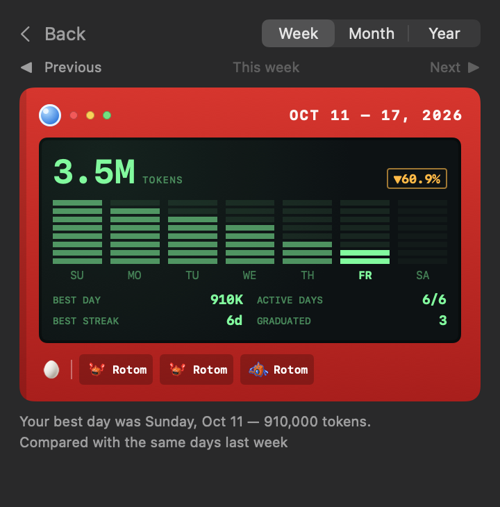

<small>The Home, Settings, form, Shop, Bag, difficulty, daily-chart, and recap images above are local renders of the production UI with sample data.</small>

## Works with

| Tool | Tracked | Official limits |
|---|---|---|
| **Claude Code** | today · 5h block · week · month | ✅ 5h / weekly |
| **Codex** | today · week · month | ✅ 5h / weekly |
| **Gemini CLI** | today · week · month | — |
| **Antigravity** | today · 5h block · week · month | ✅ 5h / weekly |
| **OpenCode** | today · 5h block · week · month | — |
| **Hermes Agent** | today · 5h block · week · month | — |
| **Cursor** | today · 5h block · week · month | — |
| **Grok CLI** | today · 5h block · week · month | — |
| **Copilot CLI** | today · 5h block · week · month | — |
| **Kiro CLI** | today · 5h block · week · month | — (estimated) |
| **Pi Agent** | today · 5h block · week · month | — |
| **omp** (oh-my-pi) | today · 5h block · week · month | — |
| **Aside** | today · 5h block · week · month | — |
| **Kimi Code** | today · 5h block · week · month | — |

All read locally — no external usage CLI required. Adding a tool is a provider implementation and registration (see [CONTRIBUTING.md](CONTRIBUTING.md)).

## Install

### Requirements

macOS 14+ (Apple Silicon or Intel). That's it — token usage is read directly from local Claude Code, Codex, Gemini CLI, Antigravity, OpenCode, Hermes Agent, Cursor, Grok CLI, Copilot CLI, Kiro CLI, Pi Agent, omp, Aside, and Kimi Code data, with no external usage CLI required.

### Homebrew

```bash
brew install --cask chattymin/tap/poke-token-bar
```

ad-hoc/self-signed; the cask strips the quarantine attribute on install.

### Manual install (without Homebrew)

Prefer not to use Homebrew? Download `PokeTokenBar.zip` from the [latest release](https://github.com/chattymin/PokeTokenBar/releases/latest), unzip it, and drag `PokeTokenBar.app` into `/Applications`.

Because the app is ad-hoc/self-signed (not notarized under an Apple Developer account), Gatekeeper shows an "unidentified developer" warning on first launch. Clear it once, either way:

- **Finder:** right-click (or Control-click) `PokeTokenBar.app` → **Open** → **Open** again in the dialog.
- **Terminal:** `xattr -dr com.apple.quarantine /Applications/PokeTokenBar.app`

(The Homebrew cask strips quarantine for you, so it needs no extra step.)

### Build from source

```bash
swift build                  # debug
swift test                   # unit tests
./scripts/build-app.sh       # release → PokeTokenBar.app → /Applications
```

## Data sources

| Source | Used for | Notes |
|---|---|---|
| `~/.claude/projects/**/*.jsonl`, `<config folder>/projects/**/*.jsonl` | Claude Code daily/blocks/weekly/monthly | read directly; deduped by message id; cached incrementally |
| `~/.claude.json`, `~/.claude-*/.claude.json` | Claude accounts: which config folders are logged in, and their names | only the `oauthAccount` block is used; folders from an exported `CLAUDE_CONFIG_DIR` or Settings → Advanced are added |
| `~/.claude/history.jsonl`, `<config folder>/history.jsonl` | Claude tokens per account; the account used last | only session ids and prompt times are read, never the prompt text; only new lines are read |
| `~/.gemini/tmp/**/chats/*.json(l)` | Gemini CLI daily/monthly | session records (`tokens` per message); weekly = daily sum |
| `~/.gemini/antigravity/conversations/*.db`<br>`~/.gemini/antigravity-cli/conversations/*.db`<br>`~/.gemini/antigravity-ide/conversations/*.db` | Antigravity daily/blocks/weekly/monthly | SQLite read-only; per-call usage from the Cascade protobuf blob; supports Antigravity 2.0/Core, CLI & IDE; its own provider, not folded into Gemini; a subscription, so no cost is estimated |
| `~/.codex/sessions/**/*.jsonl` | Codex daily/monthly | `token_count` events; weekly = daily sum |
| `~/.local/share/opencode/opencode.db` | OpenCode daily/blocks/weekly/monthly | SQLite read-only (`message` on V1, `session_message` on V2); legacy `storage/message` JSON is also supported |
| `~/.hermes/state.db` | Hermes Agent daily/blocks/weekly/monthly | SQLite read-only; session token totals and persisted cost |
| `~/Library/Application Support/Cursor/User/globalStorage/state.vscdb` | Cursor daily/blocks/weekly/monthly | SQLite read-only fallback (`cursorDiskKV` bubble `tokenCount`); when signed in, primary source is `cursor.com` dashboard API (see Privacy) |
| `cursor.com` (dashboard API) | Cursor daily/blocks/weekly/monthly | unofficial JSON endpoint (`get-filtered-usage-events`); session from `cursorAuth/accessToken` in `state.vscdb` or `CURSOR_SESSION_TOKEN`; refetches when the provider reloads; on network error falls back to an account-scoped disk cache up to 6 h old; disable with `CURSOR_USAGE_API=0` |
| `api2.cursor.sh` (dashboard limits API) | Cursor official monthly included usage | Connect RPC `GetCurrentPeriodUsage`; Bearer JWT from `state.vscdb` or `CURSOR_SESSION_TOKEN`; same disable switch as usage events |
| `~/.grok/sessions/**/updates.jsonl` | Grok CLI daily/blocks/weekly/monthly | `turn_completed` records (per-turn `usage`, server-reported cost); honours `$GROK_HOME`; subagent sessions are skipped because their tokens are already folded into the parent turn |
| `~/.copilot/session-store.db` | Copilot CLI daily/blocks/weekly/monthly | SQLite read-only; one `assistant_usage_events` row per API call; honours `$COPILOT_HOME`; `input_tokens` already contains the cached prompt, so cache reads/writes are subtracted; premium-request billing, so no cost is estimated |
| `~/Library/Application Support/kiro-cli/data.sqlite3`<br>`~/.kiro/sessions/cli/*.jsonl`<br>`~/.kiro/sessions/<ws>/<session>/messages.jsonl` | Kiro CLI daily/blocks/weekly/monthly | Pre-2.20 SQLite plus 2.20+ / `--v3` JSONL; neither store records real token counts, so input is a bytes÷4 **estimate** of accumulated conversation text resent on every turn; `usage_summary` credits are not converted to USD; a `/clear`d SQLite conversation's already-counted tokens stay counted until the app restarts; honours `$KIRO_CLI_HOME` and `$KIRO_HOME` |
| `~/.pi/agent/sessions/**/*.jsonl` | Pi Agent daily/blocks/weekly/monthly | Direct persisted usage from all projects; `$PI_CODING_AGENT_DIR` and `$PI_CODING_AGENT_SESSION_DIR` overrides supported; output already includes reasoning (not counted twice); forked history deduplicated by entry ID; source-recorded costs are retained |
| `~/.omp/agent/sessions/**/*.jsonl` | omp (oh-my-pi) daily/blocks/weekly/monthly | pi-format session JSONL; every assistant `usage` event is summed (rewound branches are already billed) and subagent session files count too, since their tokens are not folded into the parent; honours `$OMP_CODING_AGENT_DIR`; per-event `cost` is trusted when reported; `bridge/` conversion copies are skipped because their originals are already counted at the source |
| `~/.aside/u/*/state.db` | Aside daily/blocks/weekly/monthly | Read-only SQLite turn totals; deleted turns remain counted until the scan cache resets; only recorded costs are used |
| `~/.kimi-code/sessions/**/agents/*/wire.jsonl` | Kimi Code daily/blocks/weekly/monthly | Every `usage.record` (per-request, `turn` and `session` scope) is summed across main and subagent wire files; honours `$KIMI_CODE_HOME` and the Kimi desktop runtime root; `/fork` copies are folded by record content; Kimi records no cost, so cost shows as unavailable |
| Keychain (`Claude Code-credentials`, plus `Claude Code-credentials-<hash>` for each other config folder) / `<config folder>/.credentials.json` → `api.anthropic.com` | Claude official 5h/weekly % per account | unofficial endpoint; the Keychain is read **only when you press refresh** — auto-polling never reads it |
| `codex app-server` | Codex official 5h/weekly % | local child process; account snapshot only, no model turn |
| [PokéAPI](https://pokeapi.co/) — `pokeapi.co`, `graphql.pokeapi.co` | Pokémon species, stats, abilities, moves &amp; evolution | runtime fetch; cached locally, never bundled |
| `raw.githubusercontent.com/PokeAPI/sprites` | Pokémon &amp; item sprites | runtime fetch; cached under Application Support, never bundled |
| `status.claude.com`, `status.openai.com` | provider incident banner | statuspage summary; display only — turn it off in Settings |
| `api.github.com` | update check | latest release tag; on launch and when the popover opens |

If a provider's logs live **outside** those built-in paths, add the folder in **Settings → Advanced → Additional scan folders**. Pick the provider first — each folder is parsed only by that provider, so pointing a Gemini field at Claude logs would mis-attribute tokens. Extra folders are added to the built-in locations; they never replace them.

## Privacy & permissions

- **On-device first.** Token usage is read directly from local Claude Code, Codex, Gemini CLI, Antigravity, OpenCode, Hermes Agent, Cursor, Grok CLI, Copilot CLI, Kiro CLI, Pi Agent, omp, Aside, and Kimi Code data. The app never uploads usage or runs model turns. To split Claude usage between accounts, each config folder's `history.jsonl` is read for session ids and prompt times only; the prompt text is ignored and nothing leaves the Mac.
- **Outbound requests.** The app is not fully offline. It talks to thirteen hosts: `pokeapi.co` and `graphql.pokeapi.co` (species/evolution), `raw.githubusercontent.com` (sprites), `api.anthropic.com` (Claude official limits), `claude.ai` (Claude official limits when you save an optional claude.ai session key in Settings — the key only, no prompts or project paths), `cursor.com` (Cursor usage summary when you are signed into Cursor locally — session credential only, no prompts or project paths), `api2.cursor.sh` (Cursor official monthly included usage — Bearer JWT only, same credential class as the IDE login), `cloudcode-pa.googleapis.com` and `daily-cloudcode-pa.googleapis.com` (Antigravity official limits) plus `oauth2.googleapis.com` (their token refresh), `status.claude.com` and `status.openai.com` (incident banner — off switch in Settings), and `api.github.com` (update check). **None of them carry your usage logs, prompts, or project paths** — only the request itself (Cursor sends your session cookie to fetch your own usage rows, same as the web dashboard).
- **Keychain (optional).** The Claude OAuth credential is read **only when you press a refresh button** (Settings, or the limits row in the popover). Automatic polling never touches the Keychain, so it never raises a password prompt; when `~/.claude/.credentials.json` is present, each poll re-reads it, so an in-place `/login` to another account is picked up without pressing refresh. The token is held in memory only — the app creates no Keychain item of its own. If there is no credentials file, limits stay on the cached token until it expires or you refresh. Turn it off in Settings — the limits section simply hides. With several Claude accounts, a refresh also reads each other config folder's own item, once per folder, and a declined prompt stops the remaining ones.
- **Pokémon data and assets** are fetched at runtime from PokéAPI and cached only under `~/Library/Application Support/PokeTokenBar/`. Generated individual values (such as IVs, gender, ability and known moves) are stored in the local companion save so they remain stable. The app binary and its release artifacts contain no Pokémon assets.

## Contributors

Contributions of all sizes are welcome — see [CONTRIBUTING.md](CONTRIBUTING.md) for how to build, test, and open a pull request.

[](https://github.com/chattymin/PokeTokenBar/graphs/contributors)

## License & disclaimer

**MIT** — see [LICENSE](LICENSE). The MIT license covers this project's original source code only; it grants no rights to any third-party trademarks, artwork, or data accessed through the app.

PokeTokenBar is an **unofficial, non-commercial fan project**. It is **not affiliated with, endorsed, sponsored, or approved by Nintendo, Game Freak, Creatures Inc., or The Pokémon Company.** "Pokémon" and all related names, characters, and imagery are trademarks and copyrights of their respective owners. This project claims no ownership of, and asserts no rights over, any Pokémon intellectual property.

- **The app binary and its release artifacts bundle no Pokémon assets.** Pokémon species data and sprites are fetched **at runtime** from the public [PokéAPI](https://pokeapi.co) and cached locally on the user's own device; sprite images served via PokéAPI remain the property of their respective owners.
- Any Pokémon imagery in this repository's documentation (screenshots/GIFs) is shown solely to illustrate the app's functionality.
- The app is provided free of charge for **personal, non-commercial use only.**
- If you are a rights holder with any concern about this project, please open an issue or contact the maintainer, and we will respond promptly.

*Provided "as is", without warranty of any kind. This notice is not legal advice.*
